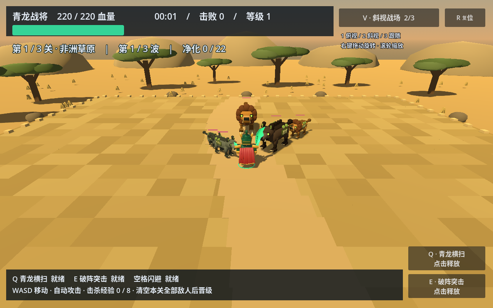
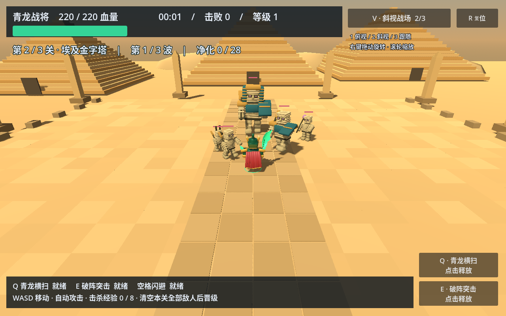
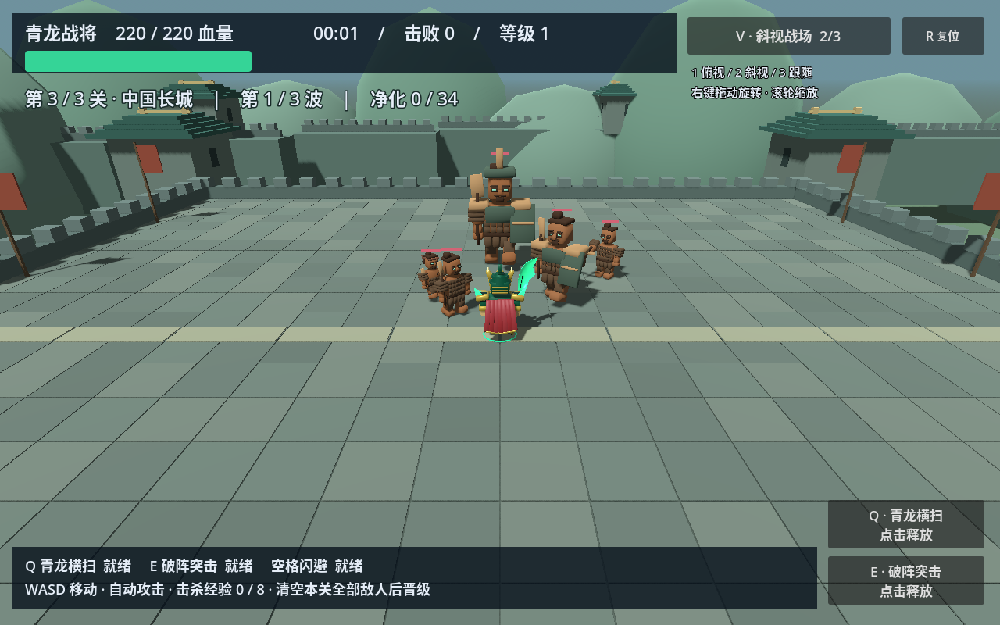

# 积木 / 远征 — Brick Outbreak MVP 0.7.0

原创积木武将 3D 单机闯关游戏。Godot 4.6.3，中文界面，无需联网。选择青龙战将、赤焰游侠或寒霜术士，连续挑战三处主题战场。

## 0.7.0：英雄成长、第三技能与难度

三名英雄各关基础血量如下。装甲升级获得的额外血量会叠加到各关基础血量上，进入新关恢复至新的血量上限。

| 英雄 | 草原基础血量 | 埃及基础血量 | 长城基础血量 |
|---|---:|---:|---:|
| 青龙战将 | 220 | 300 | 350 |
| 赤焰游侠 | 160 | 200 | 260 |
| 寒霜术士 | 180 | 220 | 260 |

在选人界面右上角选择难度，整次远征保持同一难度。所有倍率均作用于该关原有敌人数值，包含首领；不改变波次数量和攻击间隔。

| 难度 | 第一关：血量 / 移速 / 伤害 | 第二关：血量 / 移速 / 伤害 | 第三关：血量 / 移速 / 伤害 |
|---|---|---|---|
| 简单 | ×0.80 / ×0.80 / ×0.80 | ×0.80 / ×0.80 / ×0.80 | ×0.80 / ×0.80 / ×0.80 |
| 普通 | ×1.00 / ×1.00 / ×1.00 | ×1.00 / ×1.00 / ×1.00 | ×1.00 / ×1.00 / ×1.00 |
| 困难 | ×1.10 / ×1.10 / ×1.00 | ×1.15 / ×1.15 / ×1.15 | ×1.20 / ×1.20 / ×1.20 |

普通保留 0.6.0 的敌人配置；困难第三关是在第三关原值上增加 20%，不再叠乘第二关难度。难度选择在返回选人、重开及关卡之间保留，退出程序后不保存；战斗中不切换。图鉴显示当前难度下的数值，战斗 HUD 显示所选难度。

**新增第三技能统一冷却 20 秒，按 F 或点击第三个技能按钮释放；W 保留向前移动。**

- **绝气斩**：大刀下斩，发出龙首、龙身、角与爪组成的龙形剑气。沿释放时面朝方向，清除前方长 48、宽 3.2 的直线内全部敌人，包含首领；身后与侧面敌人不受影响。仍须清完本关剩余敌人才能晋级。
- **火球天降**：在释放位置标记半径 10 的范围，13 颗火球约 0.65 秒后落地，对范围内敌人结算一次 180 基础伤害。落点固定，英雄移动不会拖走已落下的火球；伤害接受攻击强化。
- **四方霜降**：以英雄为中心，沿释放时确定的四个方向持续发射冰箭，持续 3 秒、12 轮，最远 6。单个持续处于箭路内的目标累计承受 200 基础伤害，中心重叠处每轮只结算一次。箭路为宽 1.9 的直线，非整个圆形范围；后续发射位置跟随英雄移动，伤害接受攻击强化。

新技能的冷却、落地结算、持续发射和特效在暂停或升级选择时同步冻结。过关、重开清理遗留火球与冰箭；过关和重整旗鼓升级同时刷新三个技能。

[观看 21 秒第三技能演示](dist/ultimate-demo.mp4)


[查看三个难度选项](dist/difficulty.png)

[绝气斩](dist/ultimate-0.png) · [火球天降](dist/ultimate-1.png) · [四方霜降](dist/ultimate-2.png)

演示和技能截图使用固定位置的高血量敌人，并停用其攻击与自动刷新，以便观察新技能。

## 三关远征

从原先的单场限时生存改为 **有限波次、清场晋级**：

| 关卡 | 场景 | 敌人 | 三波数量 | 关底首领 |
|---|---|---|---|---|
| 第一关 · 非洲草原 | 金色草地、金合欢树、草丛、远山与土路 | 感染灰狼、疾奔野狼、铁背野猪、疫毒雄狮 | 6 / 8 / 8，共 22 个 | 感染狮王，600 血量 |
| 第二关 · 埃及金字塔 | 沙海、三座阶梯金字塔、方尖碑与石板神道 | 裹尸木乃伊、豺首木乃伊、王陵守卫、咒术木乃伊 | 8 / 10 / 10，共 28 个 | 法老王，900 血量 |
| 第三关 · 中国长城 | 城墙平台、垛口、烽火台、旌旗与山峦 | 陶俑步卒、陶俑斥候、重甲陶俑、陶俑弩手 | 10 / 12 / 12，共 34 个 | 陶俑将军，1200 血量 |

每波敌人按固定清单分批进入，同时存活上限 12。必须清空本波才能进入下一波；每关首领位于第三波末尾，**击杀首领后仍须清完剩余敌人**。不再使用原来的 02:30 首领计时与 04:00 失败限制。

前两关清场后，显示过关强化界面。选择攻击强化、装甲强化或战地补给后进入下一关，保留英雄、等级、经验和累计强化；恢复全部血量、刷新技能与闪避，并清理前一关的敌人、弹体和特效。第三关清空后显示最终通关结算。死亡后可以重新远征，重开从第一关开始。

[过关强化界面](dist/intermission.png) · [最终通关界面](dist/victory.png)

每关都有五种真实 3D 敌人模型。草原动物具备四条独立活动腿、兽首、尾巴、獠牙或鬃毛，以及感染眼、病变斑块；木乃伊使用层叠绷带、豺首面具、王陵盾甲、法杖与法老冠饰；兵马俑使用陶土面孔、发髻、扎甲、盾牌、长兵和弩。后两关普通敌人血量分别增加 15% / 30%，伤害增加 12% / 24%。

远程敌人分别发射疫毒弹、诅咒法球和弩箭。三套敌人共用受击闪白、冰霜覆盖、血条朝向、镜头遮挡淡化和死亡奖励规则，并按主题分别缓存网格，避免模型串用。场景装饰按材质合并，以控制绘制数量。

[观看 21 秒三关场景与战斗演示](dist/campaign-demo.mp4)







截图与演示使用固定敌人阵列、提前展示首领并停用敌人攻击，便于对比三关美术和技能；正常游戏按完整波次推进，敌人正常追击与攻击。视频在 Linux 软件渲染环境录制，不代表 Mac 实机帧率。

## 下载与 Mac 安装

[下载 v0.7.0 Mac 测试包](https://github.com/pipistar2017/brick-outbreak/raw/refs/tags/v0.7.0/dist/Brick-Outbreak-macOS.zip)

也可进入仓库 `dist` 目录，打开 `Brick-Outbreak-macOS.zip` 后点击 **Download raw file / 下载原始文件**。请下载该 ZIP，GitHub 的源码归档不能直接安装。

1. 解压 ZIP，将 `Brick Outbreak.app` 拖进“应用程序 / Applications”，替换旧版即可，无需安装 Godot。
2. 双击打开。最低目标系统 macOS 11，通用二进制包含 Apple Silicon arm64 与 Intel x86_64。
3. 这是临时签名测试包，未使用 Apple Developer ID 签名或公证。若系统阻止打开，先尝试启动一次，再到“系统设置 → 隐私与安全性”选择此应用的“仍要打开”。
4. 若提示“已损坏”，先重新解压并核对 `dist/SHA256SUMS.txt`。确认来源后，可在终端仅移除此应用的下载隔离标记：

   `xattr -dr com.apple.quarantine "/Applications/Brick Outbreak.app"`

不需要关闭系统 Gatekeeper 或修改全局安全设置。当前没有 Mac 实机测试；已在 Linux 验证游戏逻辑、OpenGL 实际画面、macOS 导出、包内资源及架构。此包适用于 Mac，不能直接安装到 iPad。

## 操作与视角

| 操作 | 功能 |
|---|---|
| WASD / 方向键 | 按镜头方向移动，斜向移动没有速度加成 |
| 自动普攻 | 近战范围挥刀；远程自动选择射程内最近目标 |
| Q / E / F 或右侧技能按钮 | 释放职业技能，按钮显示冷却 |
| 空格 | 短距离闪避，冷却 3 秒 |
| Esc | 暂停 / 继续 |
| 1 / 2 / 3 | 俯视战场 / 斜视战场 / 第三人称跟随 |
| V / 右上角视角按钮 | 循环切换镜头 |
| 鼠标右键拖动 / 滚轮 | 旋转与调整俯仰 / 缩放 |
| R / 复位按钮 | 恢复当前视角的默认方向、角度和距离 |

镜头与英雄自动攻击朝向独立，切换时平滑过渡；透视视角下遮挡英雄的敌人会淡化。斜视默认角度降低，便于观看关卡地标。镜头保持在场地边缘以内，靠边时安全抬高。选人界面右上角的 **远征敌人图鉴** 可以切换查看三关敌人；拖动模型可旋转查看。

击杀普通敌人获得 1 经验，首领获得 20 经验。升级需要当前等级 × 8 经验，升级三选一期间战斗暂停。等级强化：伤害增加 20% 基础值；血量上限增加 40 并恢复 65；或恢复 100 血量并刷新技能。过关强化另有一次选择，战地补给额外增加 10% 基础伤害。

## 三名积木武将

| 英雄 | 普攻 | Q | E | F（新增第三技能） |
|---|---|---|---|---|
| 青龙战将 | 30 / 0.8 秒，近身范围 | 半径 6，70 伤害，冷却 6 秒 | 向移动方向突进 6，免伤 1 秒，落点半径 5 造成 120 伤害；冷却 14 秒 | 绝气斩：直线清敌，冷却 20 秒 |
| 赤焰游侠 | 18 / 0.35 秒，射程 12 | 半径 10，75 伤害，冷却 5 秒 | 8 秒内攻击间隔缩短 40%，冷却 16 秒 | 火球天降：半径 10，180 伤害，冷却 20 秒 |
| 寒霜术士 | 24 / 0.7 秒，射程 12，减速 1 秒 | 半径 8，45 伤害、减速 3 秒，冷却 7 秒 | 半径 10，120 伤害、减速 3 秒，冷却 16 秒 | 四方霜降：四向箭路，最远 6，3 秒累计 200 伤害，冷却 20 秒 |

减速降低移速 50%，受伤后有 0.5 秒保护。近战普通攻击有约 0.1 秒出手时间，远程弹体抵达才结算伤害。普攻、六种技能、命中闪光、伤害数字、冰霜覆盖和合成音效均保留。

三名英雄统一采用参考图启发的原创积木武将风格，各有超过 100 个结构与装饰部件，包含冠甲、独立武器、关节动画与披风。选人界面展示可拖动旋转的真实模型。仍为程序化风格模型，没有复刻参考图的精密雕花、透明塑料质感或战马。

## 开发与验证

使用 Godot 4.6.3 打开 `project.godot`，按 F5 运行。macOS 导出需安装同版本导出模板。

```sh
godot --headless --path . --editor --import --quit
python3 tests/verify.py
./build.sh
```

自动检查共 **398 项**，包括三关基础血量与装甲继承、三档难度的数值/真实移速/实际攻击、第三技能方向范围与伤害时机/累计伤害/冷却/暂停/清理/键盘和按钮，以及三名英雄、普攻与技能时机、暂停、三视角操作、遮挡恢复，三关十五种敌人的模型/动作/反馈/网格共享/远程发射/图鉴，以及完整九波、84 个敌人的三关推进、首领不能跳过存活敌人、过关升级、恢复与清理、最终胜利和重开。

`./build.sh` 会重新导出 macOS ZIP，在源码与导出 PCK 上分别执行同一套 398 项检查，再检查 ZIP CRC、版本、架构、执行权限与签名加载命令，生成源码归档、测试报告及 SHA256。包内 PCK 由 Linux Godot 执行，**不等于运行 macOS 可执行文件或通过 Apple 签名验证**。

| 文件 | 职责 |
|---|---|
| `main.gd` | 战斗、三个技能、关卡状态、难度选择、波次推进、升级与 UI |
| `campaign_data.gd` | 三关主题、固定敌人清单、数值与难度倍率 |
| `stage_world.gd` | 草原、金字塔、长城场景与装饰合并 |
| `campaign_enemy.gd` | 感染动物、木乃伊、兵马俑模型与动画 |
| `zombie_model.gd` | 共享材质、网格合并、受击与遮挡反馈基类；保留旧丧尸模型供开发参考 |
| `hero_model.gd` | 三名积木武将的部件与动作 |
| `combat_fx.gd` | 刀光、弹体、冲击波、碎片与伤害数字 |
| `battle_camera.gd` | 三视角、移动方向转换、边缘处理和遮挡判断 |

开发截图：`--stage-preview=0`、`--stage-preview=1`、`--stage-preview=2`。三关演示录制：

```sh
godot --path . --fixed-fps 30 --write-movie /tmp/brick-campaign.avi -- --stage-demo
ffmpeg -i /tmp/brick-campaign.avi -c:v libx264 -crf 23 -pix_fmt yuv420p -movflags +faststart -c:a aac dist/campaign-demo.mp4
```

这是三关战斗 MVP，各关以主题场地和有限波次组织战斗；没有开放世界、联机、存档、装备系统、复杂剧情、完整触屏移动或 iOS 安装包。英雄与镜头偏好在本次运行的关卡之间保留，退出后不保存。

第三技能演示：

```sh
godot --path . --fixed-fps 30 --write-movie /tmp/brick-ultimates.avi -- --ultimate-demo
ffmpeg -i /tmp/brick-ultimates.avi -c:v libx264 -crf 23 -pix_fmt yuv420p -movflags +faststart -c:a aac dist/ultimate-demo.mp4
```

技能截图：`--skill-preview=0` / `1` / `2`。本版三关、旧多视角与战斗视频中如仍显示旧数值，以 0.7.0 的表格、当前源码和第三技能演示为准。
