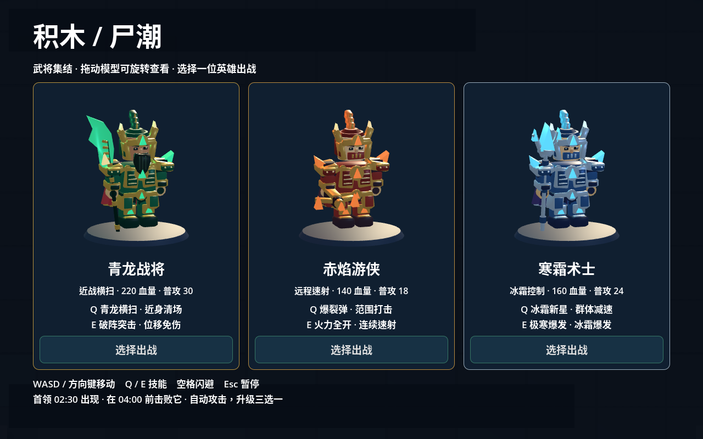

# 积木 / 尸潮 — Brick Outbreak MVP 0.2.0

原生 3D 单机生存游戏。Godot 4.6.3，采用可活动关节的程序化积木武将与 3D 场景，中文界面，无需联网。


## 0.2.0：三名积木武将



- **青龙战将**：翡翠绿与鎏金重甲、金冠、长黑须、红色金边披风、青龙偃月刀。
- **赤焰游侠**：赤金轻甲、护面冠盔、暗红披风、火焰连弩。
- **寒霜术士**：银蓝冠甲、冰晶肩饰、紫色金边长披风、冰晶法杖。

三人统一使用参考图启发的积木武将风格，各有超过 100 个 3D 装饰与结构部件。包含倒角护甲、圆柱头部与连接柱、龙首肩甲、护腕、分层胸甲、护膝和分片披风。模型是原创程序化几何，仍属风格化模型，没有复刻参考图的精密雕花、透明塑料质感和战马。

选人界面展示三名真实 3D 模型，按住鼠标左键拖动可旋转查看。进入战斗后使用同一模型，支持关节行走、近战挥刀、连弩后坐和法杖施法动作，披风随动作摆动。原有血量、伤害、技能和敌人规则保持一致。

[背面披风与后甲预览](dist/heroes-back.png) · [战斗画面](dist/gameplay.png)

## 下载测试包

进入仓库的 `dist` 目录，点击 `Brick-Outbreak-macOS.zip`，再点击 **Download raw file / 下载原始文件**。请下载该 ZIP 文件，而不是 GitHub 的整个源码压缩包。`dist/SHA256SUMS.txt` 提供校验值，`dist/TEST-REPORT.txt` 提供验证记录。

## Mac 安装

1. 解压 `Brick-Outbreak-macOS.zip`。
2. 把 `Brick Outbreak.app` 拖进“应用程序 / Applications”。无需安装 Godot。
3. 双击打开。最低目标系统 macOS 11，通用二进制包含 Apple Silicon arm64 与 Intel x86_64。
4. 这是临时签名测试包，未使用 Apple Developer ID 签名或公证。如果系统阻止打开，先尝试启动一次，再到“系统设置 → 隐私与安全性”中找到此应用并选择“仍要打开”。系统版本不同，提示可能略有不同。
5. 如果系统提示文件“已损坏”，请先重新解压并核对 SHA256。确认是本次测试包后，可在终端仅移除此应用的下载隔离标记：

   `xattr -dr com.apple.quarantine "/Applications/Brick Outbreak.app"`

不需要关闭系统 Gatekeeper 或修改全局安全设置。当前没有 Mac 实机测试；已在 Linux 验证游戏逻辑、实际 OpenGL 画面、macOS 导出、包内游戏资源与架构。

## 操作

- 鼠标：选择英雄、升级选项、结算按钮。
- WASD / 方向键：移动。
- 自动普攻：近战英雄攻击附近敌人；远程英雄自动命中射程内最近目标。
- Q / E：两个职业技能。空格：短距离闪避，冷却 3 秒。
- Esc：暂停 / 继续。窗口关闭按钮：退出游戏。
- 每击杀一个普通敌人获得 1 经验；升级需要当前等级 × 8 经验。升级选项期间暂停战斗。
- 02:30 首领出现，04:00 前击败首领即可获胜；血量耗尽或超时则失败。

## 英雄

| 英雄 | 血量 | 普攻 | Q | E |
|---|---:|---|---|---|
| 青龙战将 | 220 | 30 / 0.8 秒，附近范围攻击 | 青龙横扫：半径 4.5，伤害 70，冷却 6 秒 | 破阵突击：向移动方向瞬移 6 单位并免伤 1 秒，落点半径 5 造成 120 伤害；冷却 14 秒 |
| 赤焰游侠 | 140 | 18 / 0.35 秒，射程 12 | 爆裂弹：自身半径 6 造成 65 伤害，冷却 5 秒 | 火力全开：5 秒内攻击间隔缩短 40%，冷却 16 秒 |
| 寒霜术士 | 160 | 24 / 0.7 秒，射程 12，减速 1 秒 | 冰霜新星：自身半径 6 造成 45 伤害并减速 3 秒，冷却 7 秒 | 极寒爆发：自身半径 8 造成 120 伤害并减速 3 秒，冷却 16 秒 |

减速效果为移速降低 50%。受伤后有 0.5 秒保护。首版远程普攻为即时命中；特效为简化范围提示。

## 敌人

| 类型 | 血量 | 每次伤害 | 移速 | 特点 |
|---|---:|---:|---:|---|
| 普通（绿色） | 60 | 10 | 1.35 | 追击近战 |
| 狂奔（黄绿色） | 40 | 8 | 2.8 | 快速追击 |
| 重甲（紫色） | 240 | 25 | 0.8 | 高血量、大体型 |
| 喷吐（黄色） | 80 | 15 | 1.0 | 保持距离，发射可躲避弹体 |
| 首领（红色） | 1800 | 30 | 1.15 | 02:30 出现，大型近战目标 |

普通近战攻击间隔 1.5 秒；喷吐间隔 2.5 秒。每 25 秒逐步解锁一种普通敌人，刷新间隔随时间缩短，同时存活敌人上限 65。

## 范围与限制

这是验证玩法的 MVP：1 张平面地图、3 名英雄、4 类普通敌人、1 个首领、3 种升级、胜负重开、简单合成音效。
人物已升级为带独立武器、冠甲、披风和关节动画的原创程序化积木武将，细节仍未达到参考图精细模型水平；无常驻骑乘、联机、剧情、存档、装备系统或复杂首领招式。没有实测 Mac 性能数据。

## 开发与复现

安装 Godot 4.6.3，导入 `project.godot`，按 F6/F5 运行。

```sh
godot --headless --path . --editor --import --quit
godot --headless --path . -- --smoke-test
godot --headless --path . --export-release macOS dist/Brick-Outbreak-macOS.zip
```

macOS 导出需安装 Godot 4.6.3 的导出模板。Linux CI 可将 XDG_DATA_HOME、XDG_CONFIG_HOME、XDG_CACHE_HOME 指向可写目录。本项目不依赖 Python 教学仓库，也没有修改该仓库。

自动化验证脚本 `tests/verify.py` 会检查退出码和错误日志，共 53 项玩法与模型检查，包括三名英雄的模型接入、关节动画、实际技能效果、3D 预览和拖动旋转；传入导出的 zip 可同时核验应用结构、架构，并使用 Linux Godot 执行包内 PCK 的同一套逻辑测试。这不等于运行了 macOS 可执行文件。

```sh
python3 tests/verify.py dist/Brick-Outbreak-macOS.zip
```


完整复现导出、源码归档、校验和与包内测试：

```sh
./build.sh
```

`hero_model.gd` 独立管理三名英雄的部件、共享材质、网格缓存和动画；`main.gd` 管理战斗与选人界面。默认下载链接保持不变，应用版本为 0.2.0。
